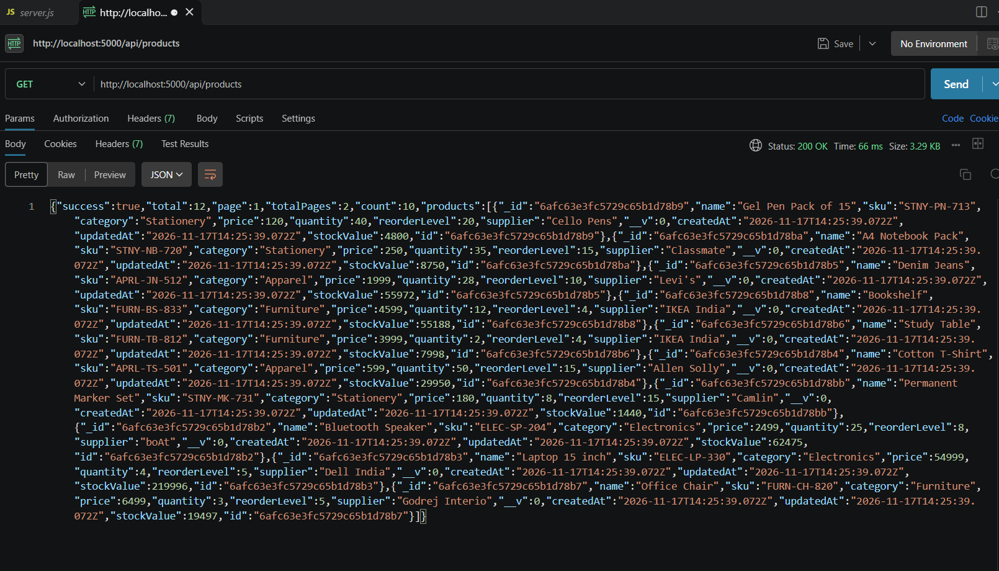
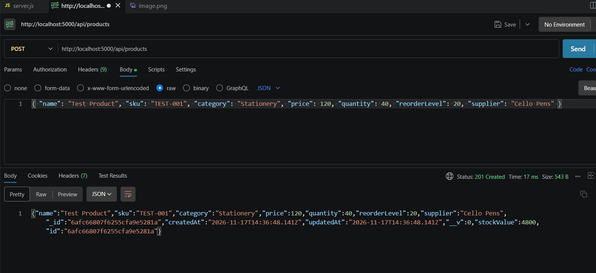
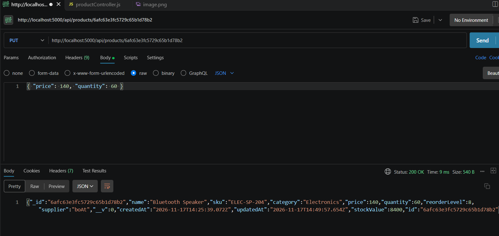
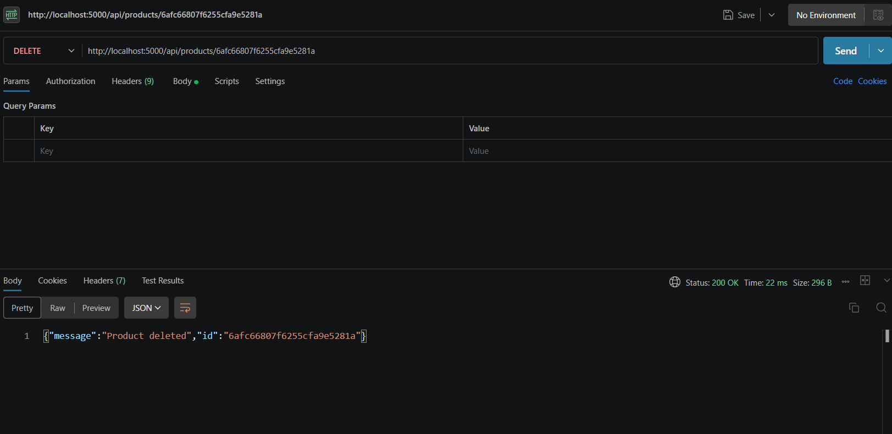

# Inventory and Data Management System

RESTful backend built with **Node.js, Express.js, MongoDB (Mongoose) and dotenv**.

## Setup
```bash
npm install
cp .env.example .env     # edit MONGO_URI if needed
npm run seed             # optional: inserts 12 sample products (5 categories)
npm start                # http://localhost:5000
```
Requires a running MongoDB (local, or an Atlas URI in `.env`).

## Project structure
```
server.js
seed.js
src/
  config/db.js
  models/Product.js                 # schema + validation + stockValue virtual
  controllers/productController.js
  routes/productRoutes.js
  middleware/                       # errorHandler, asyncHandler, validateObjectId, validateStockChange
```

## Endpoints
| Method | URL | Description |
|--------|-----|-------------|
| POST | /api/products | Create product |
| GET | /api/products | List with filter / sort / pagination |
| GET | /api/products/:id | Get single product |
| PUT | /api/products/:id | Update product details |
| PATCH | /api/products/:id/stock | Restock / sale: `{ "change": 10 }` or `{ "change": -3 }` |
| DELETE | /api/products/:id | Delete product |
| GET | /api/products/low-stock | Items where quantity <= reorderLevel (aggregation) |
| GET | /api/products/summary | Category-wise summary (aggregation) |

### Query parameters for GET /api/products
`category`, `supplier`, `search` (name/SKU), `minPrice`, `maxPrice`, `inStock=true|false`,
`sort` (e.g. `price,-name`), `page` (default 1), `limit` (default 10, max 100).

Example: `GET /api/products?category=Furniture&minPrice=1000&sort=-price&page=1&limit=5`

### Sample bodies
POST:
```json
{ "name": "Gel Pen Pack of 15", "sku": "STNY-PN-713", "category": "Stationery",
  "price": 120, "quantity": 40, "reorderLevel": 20, "supplier": "Cello Pens" }
```
PATCH `/api/products/:id/stock`:
```json
{ "change": 10 }
```

## Design notes
- Schema validation: required fields, min values, integer quantity, SKU format, unique + uppercase SKU.
- `stockValue` is a virtual (`price * quantity`) included in JSON output.
- Stock adjustment uses an atomic `$inc` with a guard, so stock never goes below zero.
- Centralized error handler maps validation (400), bad ids (400), duplicate SKU (409), missing resources (404).
- Static routes (`/low-stock`, `/summary`) are registered before `/:id`.
## API Screenshots (Postman)

### 1. Get All Products (total 12, 10 per page)


### 2. Create Product (POST)


### 3. Update Product (PUT)


### 4. Delete Product (DELETE)
